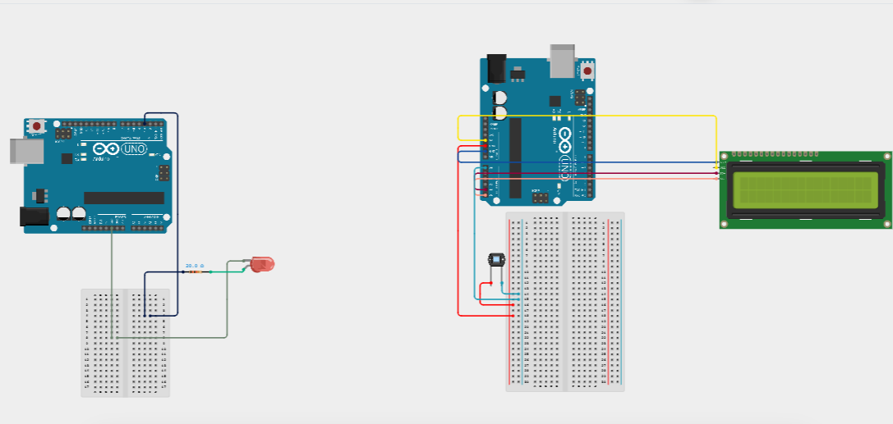
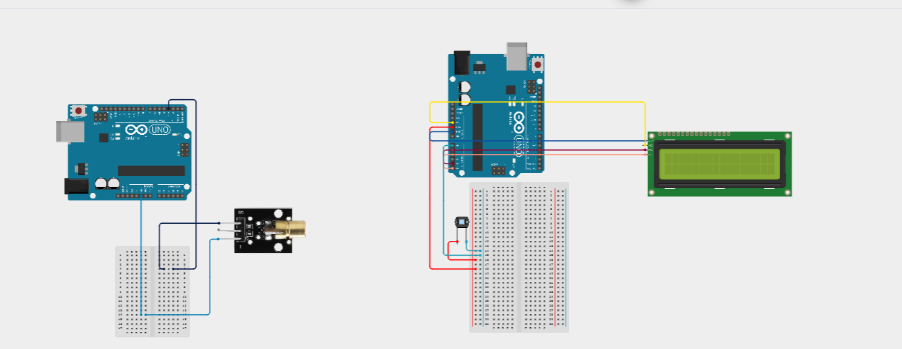

# Li-Fi / VLC Circuit Connections

This document describes two transmitter configurations for our Arduino-based Visible Light Communication (VLC) project:

1. LED-Based VLC
2. Laser-Based VLC

Both configurations can be tested with the BPW34 photodiode receiver and a 16×2 I2C LCD.

---

## 1. LED-Based VLC Circuit

### Components
- Arduino Uno
- Red LED
- Current-limiting resistor
- Breadboard
- Jumper wires
- USB cable

### Transmitter Connections

| Arduino Uno Pin | Connection |
|---|---|
| D3 | LED output through a current-limiting resistor |
| GND | LED return/cathode side |

The transmitter code uses:

```cpp
#define LED_PIN 3
```

### Working Principle

The Arduino switches the LED ON and OFF according to the transmitted digital data. These light variations carry information to the BPW34 photodiode receiver.

### LED Circuit Image



---

## 2. Laser-Based VLC Circuit

### Components
- Arduino Uno
- HW593 laser module
- Jumper wires
- USB cable

### Laser Transmitter Connections

| Laser Module Pin | Arduino Uno Connection |
|---|---|
| S (Signal) | Digital pin D3 |
| - (GND) | GND |
| + (VCC), if present | According to the module specifications |

The laser module uses digital pin D3 as its control signal.

### Working Principle

The Arduino controls the laser through its signal pin. If the module supports active-HIGH control, D3 HIGH turns the laser ON and D3 LOW turns it OFF.

For a constant-light intensity experiment, the laser can remain ON while the receiver measures the light detected by the BPW34.

**Important:** Verify the exact HW593 module pinout and supply requirements before powering it. Do not assume all modules have identical internal circuitry.

### Laser Circuit Image



---

## 3. Common Receiver Circuit

### Components
- Arduino Uno
- BPW34 photodiode
- 16×2 I2C LCD
- Resistor(s) used in the photodiode sensing circuit
- Breadboard
- Jumper wires
- USB cable

The same receiver can be used to test either transmitter, provided the received signal is compatible with the sensing circuit.

### BPW34 Connections

| Receiver Arduino Pin | Connection |
|---|---|
| A0 | Photodiode sensor output / sensing node |
| 5V | Sensor circuit supply, if required |
| GND | Sensor circuit ground |

The receiver code reads the sensor through:

```cpp
const int SENSOR_PIN = A0;
```

The Arduino uses `analogRead(A0)` to measure the sensor voltage.

The BPW34 is polarity-sensitive. Verify its pinout and the actual sensing circuit before powering it.

---

## 4. I2C LCD Connections

The receiver code uses:

```cpp
LiquidCrystal_I2C lcd(0x27, 16, 2);
```

| LCD Pin | Arduino Uno Pin |
|---|---|
| VCC | 5V |
| GND | GND |
| SDA | A4 |
| SCL | A5 |

The LCD displays the received message or measured light-intensity readings, depending on the receiver program being used.

---

## 5. LED Data Transmission Format

The LED transmitter uses the following timing values:

```cpp
BIT_TIME   = 150 ms
START_TIME = 600 ms
GAP_TIME   = 300 ms
```

Each byte contains:
- One start bit
- Eight data bits, transmitted least-significant-bit first
- One stop bit

The transmitter sends the message length, message characters, and an XOR checksum. The receiver recalculates the checksum to detect transmission errors.

---

## 6. Complete System Overview

### LED Configuration

```text
Transmitter Arduino
        |
       D3
        |
 LED + Resistor
        |
   Visible Light
        |
      BPW34
        |
 Receiver Arduino
        |
      I2C LCD
```

### Laser Configuration

```text
Transmitter Arduino
        |
       D3
        |
 HW593 Laser Module
        |
    Laser Light
        |
      BPW34
        |
 Receiver Arduino
        |
      I2C LCD
```

The transmitter and receiver communicate through light, so no data wire is required between the two Arduino boards.

---

## 7. Important Notes

1. LED and laser are alternative transmitter configurations.
2. The receiver reads the BPW34 sensing circuit through A0.
3. The LCD uses A4 for SDA and A5 for SCL.
4. The current data-transfer firmware supports messages of up to 16 characters.
5. Keep the transmitter and receiver aligned and reduce ambient-light interference.
6. The currently documented receiver setup does not use the LM358.
7. Constant laser illumination is suitable for intensity measurements. Digital data transmission requires switching the laser according to the transmission protocol.
8. Never point the laser toward anyone's eyes. Control direct and reflected beams, especially when using mirrors.

